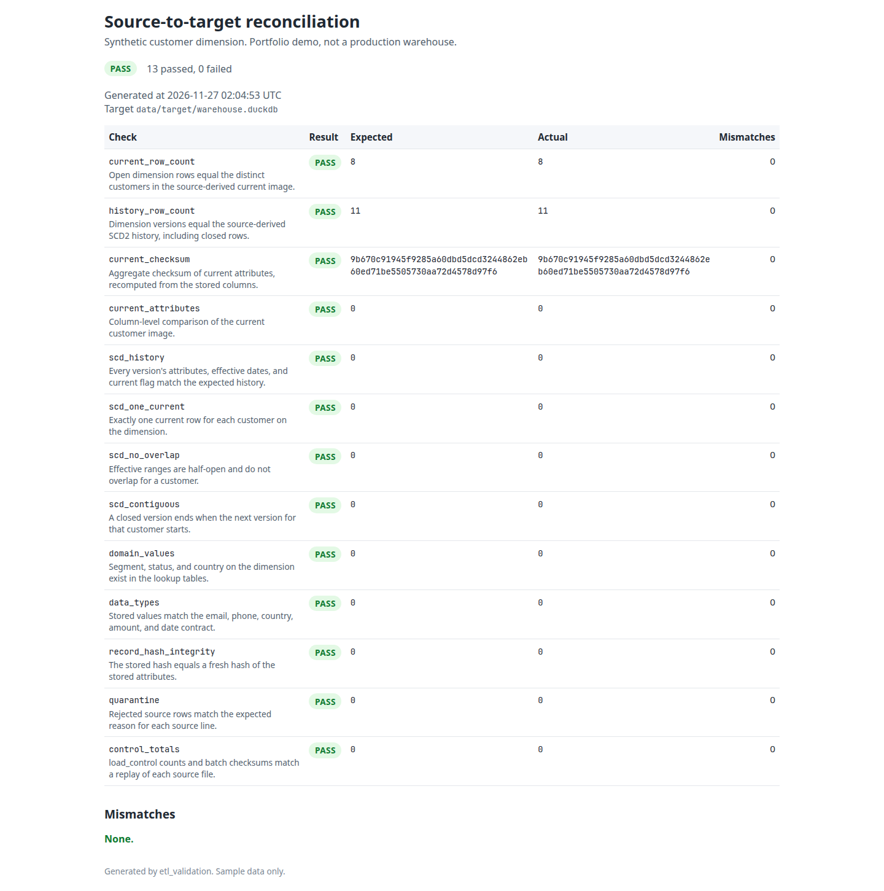

# ETL Source-to-Target Validation

[](https://github.com/Potucky/behave-selenium-login/actions/workflows/ci.yml)

Portfolio demo for QA Automation / Data QA review. Two synthetic customer files are cleaned, deduplicated, and loaded into a DuckDB dimension with SCD Type 2. A pytest suite then reconciles that warehouse to the source: row counts, an attribute checksum, column diffs, mapping and type checks, duplicate handling, and the SCD history.

This is not employer code. The files in `data/` are synthetic. Nothing here connects to a production warehouse, and the repository contains no credentials.

## What this demonstrates

- A small but explicit ETL contract: what is rejected, which duplicate wins, and when a change opens a new dimension version.
- Source-to-target reconciliation that fails with the customer, column, expected value, and actual value.
- An in-memory SCD2 expectation that is separate from the DuckDB SQL load, so a bad merge does not grade its own homework.
- Control totals (`load_control`) and a quarantine table, which is where rejected source rows go instead of disappearing.
- Configuration from a YAML file, with environment variables for the paths a test or CI job needs to override.
- A GitHub Actions run that executes the tests and uploads JUnit, pytest HTML, and the reconciliation report.

## Tech stack

| Piece | Role |
| --- | --- |
| Python 3.12 | Language CI runs |
| pandas | File reads and the in-batch transforms |
| DuckDB | Local stand-in for the warehouse |
| pytest | Unit and integration checks |
| pytest-html | Self-contained HTML test report |
| PyYAML | Pipeline configuration |
| GitHub Actions | Test run on push and pull request |

DuckDB is the warehouse in this demo. The checks are the kind you would point at Snowflake or PostgreSQL: counts, checksums, domain lookups, and effective-date invariants. This project does not ship a Snowflake connector.

## Scenario

`dim_customer` is a daily SCD Type 2 dimension. Each CSV is one batch. Files are loaded in lexical filename order, so the dates in the names are the batch order.

Tracked attributes are name, email, phone, country, segment, status, and credit limit. A change to any of them closes the current version and opens a new one. A newer row with the same attribute hash does not create a version. A row whose `source_updated_at` is not newer than the current version is ignored, even if the attributes differ.

Effective ranges are half-open. A closed row's `effective_to` equals the next version's `effective_from`. The open end is `9999-12-31`.

| Source | Rule |
| --- | --- |
| `customer_id` | Required. Trimmed and uppercased. Letters and digits only. |
| `full_name` | Required. Whitespace collapsed, then simple title case. |
| `email` | Trimmed, lowercased, and matched against a small `local@domain.tld` pattern. |
| `phone` | Digits only, 10 to 15 digits. |
| `credit_limit` | `$` and thousands separators removed. Negative amounts and more than two decimal places are rejected rather than rounded. |
| `country_code`, `segment_code`, `status_code` | Must exist in `data/lookups/`. The dimension stores the lookup name (`Retail`), not the source code (`R`). |
| `source_updated_at` | Parsed as a UTC timestamp. This is the version timestamp and the dedup clock. |

When several rules fail on one row, the first reason in that list wins, so the quarantine reason is stable.

Dedup is inside the accepted rows of a batch. The survivor is the latest `source_updated_at`. A tie keeps the later source row. A rejected duplicate does not block a valid row for the same customer.

The sample batches are built so the checks have something to prove:

| Batch | What it contains | Result |
| --- | --- | --- |
| `customers_20260115.csv` | 13 rows. One duplicate `C005`. Five rejects (bad email, blank id, negative credit, unknown country, unknown segment). | 7 inserted, 1 duplicate, 5 quarantined |
| `customers_20260122.csv` | Unchanged `C001`. Email, credit, and status changes for `C002`, `C003`, and `C004`. New `C013`. A stale `C002` duplicate. A late `C010` replay. A bad phone. | 1 insert, 3 new versions, 1 unchanged, 1 late skip, 1 duplicate, 1 quarantined |

After both batches the dimension has **8 current rows and 11 versions**. Six source rows are in quarantine. `C010` still shows `frank@example.com` from 15 January, because the 10 January replay is late.

Title case is a demo rule. It is the wrong cleaner for names such as McDonald; the sample simply does not contain those names.

## Project structure

```text
config/pipeline.yaml          source, lookup, database, and report paths
data/source/                  two customer batches
data/lookups/                 country, segment, and status maps
src/etl_validation/
  extract.py                  read CSVs and build one prepared batch per file
  transform.py                cleaning, reject reasons, dedup, attribute hash
  expected.py                 in-memory SCD2 fold used as the expected history
  load.py                     DuckDB schema and the SQL SCD2 merge
  pipeline.py                 full rebuild
  reconcile.py                counts, checksum, column diff, SQL invariants
  report.py                   Markdown and HTML reports
  cli.py                      `run` and `reconcile`
tests/                        unit rules plus the loaded sample warehouse
.github/workflows/ci.yml      pytest, then the sample report, uploaded as an artifact
```

Warehouse tables:

- `dim_customer` — SCD2 versions, including `record_hash`, `effective_from`, `effective_to`, and `is_current`
- `quarantine` — rejected source rows and the raw payload
- `load_control` — per-batch counts and the checksum of accepted rows
- `ref_country`, `ref_segment`, `ref_status` — the lookup tables the domain check joins to

## Run it locally

Requires Python 3.12. From the repository root:

```bash
python3 -m venv .venv
source .venv/bin/activate
python -m pip install -r requirements-dev.txt
export PYTHONPATH=src

python -m pytest
python -m etl_validation run
python -m etl_validation reconcile
```

`make test`, `make run`, and `make reconcile` call the same commands. `reconcile` writes `reports/reconciliation.md` and `reports/reconciliation.html`, prints the Markdown report, and exits `1` when any check fails.

`run` deletes the target database and reloads every source file. It is a repeatable rebuild of this sample, not a scheduler you point at a live warehouse.

Direct dependencies are pinned in `requirements.txt`. Test and report packages are pinned in `requirements-dev.txt`.

## Configuration

`config/pipeline.yaml` holds the source glob, lookup paths, target database, report directory, and the open-ended SCD date. Paths in the file are relative to the repository root.

| Variable | Overrides |
| --- | --- |
| `ETL_CONFIG` | path to the YAML file |
| `ETL_SOURCE_DIR` | source directory |
| `ETL_TARGET_DB` | DuckDB file |
| `ETL_REPORT_DIR` | report directory |

Tests point `ETL_TARGET_DB` and `ETL_REPORT_DIR` at a temporary directory. No secrets are read.

## Sample output

```text
customers_20260115.csv: extracted=13 accepted=7 rejected=5 duplicates=1 inserted=7 versioned=0 unchanged=0 skipped_late=0
customers_20260122.csv: extracted=8 accepted=6 rejected=1 duplicates=1 inserted=1 versioned=3 unchanged=1 skipped_late=1
```

Reconciliation of that load:



```text
# Source-to-target reconciliation

- Result: **PASS**
- Target: `data/target/warehouse.duckdb`
- Checks: 13 passed, 0 failed

| Check | Result | Expected | Actual | Mismatches |
| --- | --- | --- | --- | ---: |
| `current_row_count` | PASS | 8 | 8 | 0 |
| `history_row_count` | PASS | 11 | 11 | 0 |
| `current_checksum` | PASS | 9b670c91945f9285a60dbd5dcd3244862eb60ed71be5505730aa72d4578d97f6 | 9b670c91945f9285a60dbd5dcd3244862eb60ed71be5505730aa72d4578d97f6 | 0 |
| `current_attributes` | PASS | 0 | 0 | 0 |
```

The same report lists a mismatch when the warehouse is wrong. This excerpt is from a copy of the database after `C003`'s current email was changed by hand. The sample files themselves still pass.

```text
- Result: **FAIL**

| `current_checksum` | FAIL | 9b670c91945f9285a60dbd5dcd3244862eb60ed71be5505730aa72d4578d97f6 | 4873759e437873e6507fb20071a75d6704b28c5a544707818935cc7536534c07 | 0 |

### `current_attributes`

| Key | Column | Expected | Actual |
| --- | --- | --- | --- |
| C003 | email | cara@example.com | tampered@example.com |
```

The checksum is an aggregate, so it tells you the current image moved. `current_attributes` tells you which customer and column. `record_hash_integrity` also fails, because the stored hash no longer matches the stored email.

## Tests

47 tests, no sleeps, no network. `pytest -m unit` stays on the cleaning rules. `pytest -m integration` rebuilds the warehouse in a temporary DuckDB file.

Covered:

- Normalization and the reject priority, including a bad duplicate that must not block a valid row
- Lookup hits and misses, and the dimension storing names rather than source codes
- Dedup by latest timestamp, with the later source row as the tie-break
- SCD2 insert, no-op when the hash matches, close-and-open on a real change, and a late row that must not overwrite history
- Current and history row counts, the attribute checksum, and a column-level diff
- SQL invariants: one current row, no overlapping ranges, contiguous versions, lookup domains, and stored formats
- Quarantine identities and `load_control` totals for both batches
- A tampered email, a bad phone, a segment outside the lookup, and an overlapping effective range, each asserted by the check that should catch it
- Markdown and HTML report contents, and the CLI exit code

The cleaning functions are shared by the loader and the replay on purpose, so there is one field contract. Those functions are pinned by the unit tests above. Versioning is not shared: `load.py` merges in SQL, `expected.py` folds the batches in Python, and reconciliation diffs them. A broken `UPDATE` or `INSERT` fails `scd_history` and `control_totals` even though the cleaner is unchanged.

Not covered, and not claimed:

- Large volumes, runtime, or memory
- Two attribute changes on the same calendar day
- Schema drift, late-arriving lookup changes, or a parallel load
- A connection to Snowflake, PostgreSQL, or any other live warehouse
- A line-coverage percentage. The suite is aimed at the contract above, not at a coverage gate

CI (`.github/workflows/ci.yml`) runs on every push and pull request, on Python 3.12. It runs pytest with JUnit XML and a self-contained HTML report, rebuilds the sample warehouse, writes the reconciliation report, and uploads all four files as the `test-reports` artifact. The badge tracks that workflow on the default branch.

## Reconciliation checks

| Check | What it compares |
| --- | --- |
| `current_row_count` | Open dimension rows vs the expected current customers |
| `history_row_count` | All versions, including closed ones |
| `current_checksum` | SHA-256 of `customer_id` plus a fresh hash of the current attributes |
| `current_attributes` | Column diff of the current image |
| `scd_history` | Attributes, effective dates, and `is_current` for every version |
| `scd_one_current` | One current row per `customer_id` |
| `scd_no_overlap` | Half-open ranges do not overlap |
| `scd_contiguous` | A closed `effective_to` equals the next `effective_from` |
| `domain_values` | Segment, status, and country exist in the lookup tables |
| `data_types` | Email, phone, country code, decimal amount, boolean, and date order |
| `record_hash_integrity` | Stored hash vs a hash recomputed from the stored columns |
| `quarantine` | Source file, row number, customer, reason, and raw payload |
| `control_totals` | Per-batch counts and the accepted-row checksum |

The attribute hash is SHA-256 over the tracked fields, joined with an ASCII unit separator. Credit limit is formatted with two decimal places before it is hashed. The business key is not part of the hash; it is part of the aggregate checksum.
